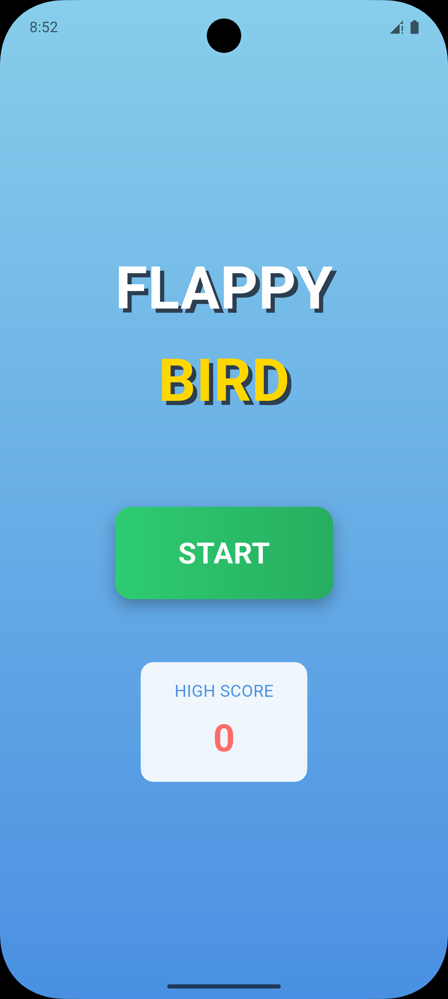
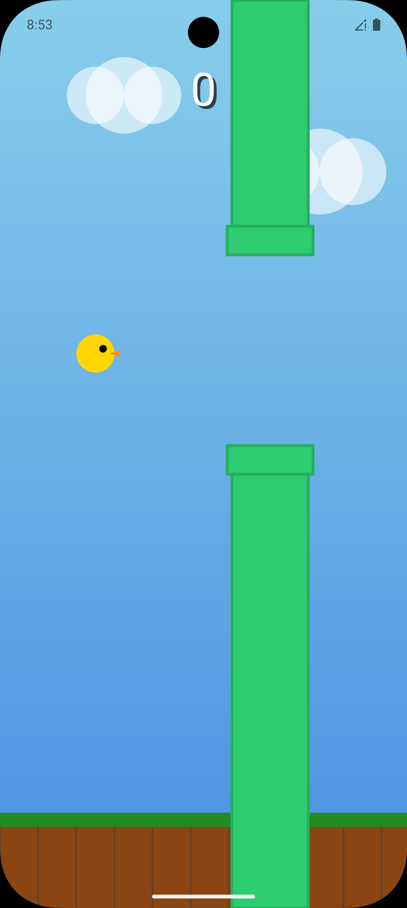
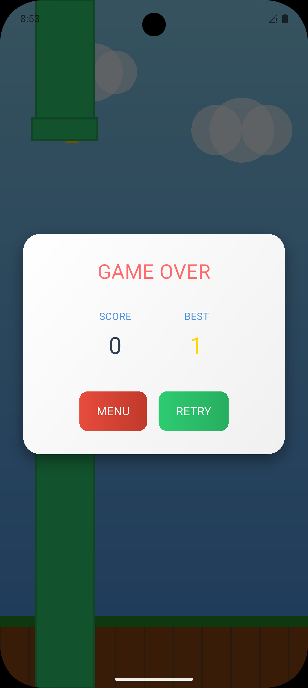

# flappy_flame

an experimental flappy ***birb*** game on flame package

nothing to read here, just build it and play when bored

---

## 🚀 Overview
Flappy Flame is a simple, addictive side-scrolling game where you control a ***birb*** and try to dodge pipes for as long as your reflexes allow. This project is a playground for the [Flame](https://flame-engine.org/) game engine in Flutter, and for anyone who just wants to procrastinate productively.

---

## 🎮 Features
- Classic flappy ***birb*** gameplay
- Smooth animations and physics
- Score tracking and persistent high score
- Responsive controls for mobile and desktop
- Modular code structure for easy extension
- Background music (calm on the home screen, upbeat while playing) with an on/off button that remembers your choice
- Easy-to-customize settings for students (`lib/workshop/`)
- Cross-platform: Android, iOS, Web, Windows, macOS, Linux

---

## 🛠️ Getting Started

### Prerequisites
- [Flutter SDK](https://flutter.dev/docs/get-started/install)
- [Dart](https://dart.dev/get-dart)
- Compatible IDE (VS Code, Android Studio, etc.)

### Installation
1. **Clone the repository:**
   ```sh
   git clone https://github.com/NiikhilRaj/flappy_flame.git
   cd flappy_flame
   ```
2. **Install dependencies:**
   ```sh
   flutter pub get
   ```
3. **Run the app:**
   - **Android/iOS:**
     ```sh
     flutter run
     ```
   - **Web:**
     ```sh
     flutter run -d chrome
     ```
   - **Windows/macOS/Linux:**
     ```sh
     flutter run -d windows  # or macos/linux
     ```

---

## 📂 Project Structure
```
lib/
  main.dart            # Entry point
  game/                # Game logic and components
  models/              # Difficulty modes
  screens/             # UI screens
  services/            # Score + audio (sound effects and music)
  widgets/             # Custom widgets (buttons, overlay, music toggle)
  workshop/            # Student-friendly settings (game_settings.dart, student_code.dart)
assets/audio/music/    # Background music (menu.wav, game.wav)
workshop/              # Student guides + sounds/ (sound effects) and assets/ (images)
tools/                 # generate_audio.py, build_vercel_site.ps1 / .sh
vercel-site/           # The compiled website that Vercel publishes
android/ios/web/linux/macos/windows/  # Platform-specific files
```

---

## 🎵 Music & Sound

| What | Where |
| --- | --- |
| Home-screen music | `assets/audio/music/menu.wav` |
| In-game music | `assets/audio/music/game.wav` |
| Sound effects | `workshop/sounds/` (`jump`, `score`, `hit`, `swoosh`) |
| File names, volumes, first-launch default | `lib/workshop/game_settings.dart` (BACKGROUND MUSIC / SOUND) |
| Playback code | `lib/services/audio_service.dart` |

- The 🎵 button (top-right on the home and game screens) turns the music on/off. The choice is saved on the device.
- Only one music track can play at a time, and asking for the track that is already playing does nothing, so music never doubles up when you move between screens or restart.
- **On the web, browsers block sound until you tap once.** The music starts on your first tap.
- All music and effects are original: they were generated by `tools/generate_audio.py` (`pip install numpy scipy`, then `python tools/generate_audio.py`), so there are no licensing restrictions.

---

## 🧪 Test it on Windows

```powershell
cd flappy_flame_github_vercel
flutter pub get
flutter analyze
flutter test
flutter run -d windows     # needs Visual Studio with "Desktop development with C++"
flutter run -d chrome      # or test the web version
```

---

## 🌐 Publish the web version (GitHub + Vercel)

The compiled website lives in `vercel-site/` and is rebuilt with one command:

```powershell
.\tools\build_vercel_site.ps1          # Windows PowerShell
bash tools/build_vercel_site.sh         # macOS / Linux / Git Bash
```

It runs `flutter build web --release` and copies `build/web` into `vercel-site/`.
Commit and push it, then in Vercel use: **Root Directory** `vercel-site`,
**Framework Preset** Other, **Build Command** empty, **Output Directory** `.`

---

## 🖼️ Screenshots

| Home Screen | Gameplay | Scoreboard |
|-------------|----------|-----------|
|  |  |  |

---

## ✨ Credits
- [Flame Engine](https://flame-engine.org/)
- [Flutter](https://flutter.dev/)
- Inspired by the original Flappy Bird

---


## 🤝 Contributing
Pull requests are welcome! For major changes, please open an issue first to discuss what you would like to change.

---

## 📬 Contact
For questions or feedback, open an issue or reach out via [GitHub](https://github.com/NiikhilRaj).
